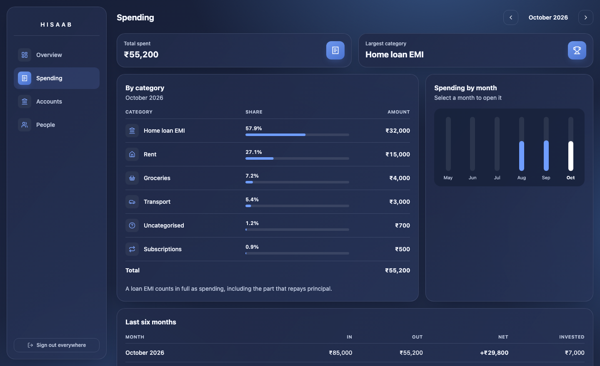
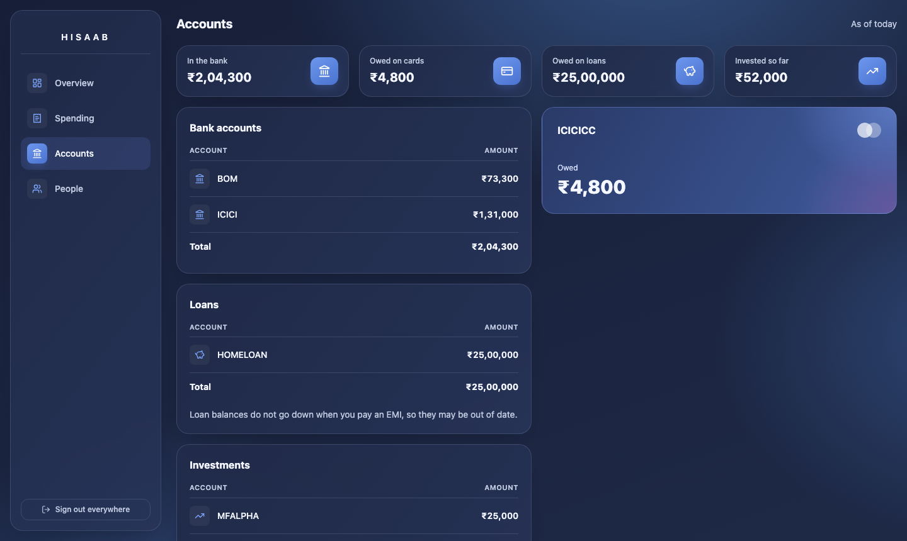

# Hisaab

_Hisaab_ is Hindi for accounts, or a reckoning.

A personal finance ledger you write to by chat message, with a dashboard that turns the log into
cash-flow visibility. Send `petrol 4k cc icici` to a Telegram bot and it is recorded, categorised and
counted correctly, with no app to open and no form to fill in.

It is single-user by design. There is no hosted version: you run your own copy with your own tokens.


## What it does

| Message | What gets recorded |
|---|---|
| `petrol 4k cc icici` | Expense on the card. Counts as spending now. |
| `pay icicicc 4k from icici` | Transfer that clears the card. Not spending, because the swipe already counted. |
| `xfer 10k icici mfalpha` | Transfer into an investment. Not spending, and shown separately as Invested. |
| `dinner 4000 split john 1000 sam 1000 cc icici` | Only your own share is spending; the rest is owed to you. |
| `bal icici 85000` | Reconciles to the real balance with a visible correction, kept out of cash flow. |
| `undo` | Voids the latest transaction. Nothing is ever deleted. |

The full grammar and worked examples are in [`docs/SPEC.md`](docs/SPEC.md).

## Why it is built this way

- **Money is integer paise in `BigInt`.** Never floats, and amounts that are not whole paise are refused rather than rounded.
- **Parsing is deterministic.** Amounts, accounts and transaction types never come from an LLM.
- **Balances are derived**, from an opening balance plus entries. No running balance is stored, so it cannot drift.
- **Ambiguous input writes nothing.** The bot asks a question instead of guessing.
- **Webhook replays are no-ops**, enforced by a unique key claimed in the same database transaction as the write.
- **`core` is pure.** It has no I/O imports, enforced by lint, so the ledger rules are tested without a database and the chat channel can be swapped.
- **The dashboard runs no JavaScript in the browser.** Its CSP is `script-src 'none'`. It connects as a database role that cannot write to the ledger or read message text.

The reasoning, including what was rejected and what later proved wrong, is in [`docs/DECISIONS.md`](docs/DECISIONS.md).

## Architecture

```
Telegram bot
        |  webhook (HTTPS)
        v
API Gateway -> Lambda: channel adapter
        |  verify secret token, allowlist sender
        v
packages/core: ingest -> dedupe -> parse -> validate -> ledger write
        |
        v
Postgres (Supabase) via Drizzle
        ^
        |  server-side reads, least-privilege role
Next.js dashboard (Better Auth + Google OAuth, email allowlist)
```

| Path | Holds |
|---|---|
| `packages/core` | Money, parser, ledger rules, reports. No I/O. |
| `packages/db` | Drizzle schema, migrations, stores, row-level security. |
| `apps/adapter` | Lambda webhook handler. [Setup and deploy](apps/adapter/README.md). |
| `apps/dashboard` | Server-rendered Next.js pages. [Setup and deploy](apps/dashboard/README.md). |

**Stack:** TypeScript (strict), Node 22, pnpm workspaces, Drizzle, Postgres, Vitest, fast-check, AWS Lambda with SAM, Next.js.

## Screens





All screenshots use the fake data from `pnpm --filter @hisaab/db db:seed`.

## Run it locally

You need Node 22, pnpm and Docker.

```bash
pnpm install
cp packages/db/.env.example packages/db/.env   # choose a local password
pnpm --filter @hisaab/db db:up
pnpm db:migrate
pnpm test
```

`pnpm --filter @hisaab/db db:seed` fills a separate local database, `hisaab_demo`, with fake data.

## Testing

The worked examples in the spec run as acceptance tests, and ledger invariants run as property tests with fast-check.
Both storage implementations pass one shared contract suite, and the dashboard's database role is tested against real
Postgres for what it can and cannot do.

```bash
pnpm typecheck && pnpm lint && pnpm test
```

## License

[MIT](LICENSE)
